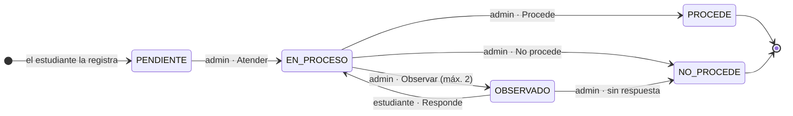
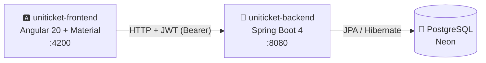

<div align="center">

# 🎓 UniTicket

**Plataforma de solicitudes académicas y administrativas para estudiantes universitarios.**
El estudiante registra su trámite; el administrador lo atiende, lo observa si falta algo y decide si procede o no.
Cada cambio de estado le llega al estudiante como notificación.


*Proyecto del curso Desarrollo Web Integrado · Universidad Tecnológica del Perú*

</div>

---

## 📑 Contenido

- [Qué hace](#-qué-hace)
- [Ciclo de vida de una solicitud](#-ciclo-de-vida-de-una-solicitud)
- [Arquitectura](#-arquitectura)
- [Estructura del repositorio](#-estructura-del-repositorio)
- [Cómo levantar el proyecto](#-cómo-levantar-el-proyecto)
- [API REST](#-api-rest)
- [Equipo](#-equipo)
- [Cómo contribuir](#-cómo-contribuir)

---

## ✨ Qué hace

| | 🧑‍🎓 Estudiante | 🛠️ Administrador |
|---|:---:|:---:|
| Registrar una solicitud eligiendo su categoría | ✅ | — |
| Ver y filtrar solicitudes | Solo las suyas | Todas |
| Atender una solicitud (pasa a *En proceso*) | — | ✅ |
| Observar con un comentario (máximo 2 veces) | — | ✅ |
| Responder una observación | ✅ | — |
| Decidir: *Procede* / *No procede* | — | ✅ |
| Notificaciones en el panel lateral | Cambios de estado | Solicitudes nuevas y respuestas |
| Indicadores y gráfico por categoría | Los suyos | Globales |
| Gestionar usuarios (crear, editar, activar/desactivar) | — | ✅ |

**Categorías:** Certificado de estudios · Cita con tutor · Pensión y pagos · Trámite de documentos.

---

## 🔄 Ciclo de vida de una solicitud



- Solo el administrador cambia el estado. El estudiante únicamente responde observaciones.
- *Observar*, *Procede* y *No procede* exigen un comentario, que queda en el **seguimiento** de la solicitud.
- Cada transición genera una **notificación**.

---

## 🏗️ Arquitectura



| Capa | Tecnología |
|---|---|
| **Frontend** | Angular 20 standalone · signals · Reactive Forms · `@if` / `@for` · Angular Material (M3) · Tailwind CSS v4 + SCSS · sin SSR |
| **Backend** | Java 25 · Spring Boot 4.1 · Spring Web · Spring Data JPA · Spring Security · JWT (jjwt) · Bean Validation |
| **Base de datos** | PostgreSQL en Neon |
| **Build** | Gradle (backend) · Angular CLI / npm (frontend) |

---

## 📁 Estructura del repositorio

```
uniticket/
├── uniticket-backend/        API REST en Spring Boot
│   ├── src/main/java/pe/edu/utp/uniticket_backend/
│   │   ├── controller/       Endpoints REST
│   │   ├── dto/              Objetos de entrada y salida
│   │   ├── model/            Entidades JPA
│   │   ├── repository/       Acceso a datos
│   │   ├── service/          Reglas de negocio
│   │   ├── security/         JWT, filtro y configuración de seguridad
│   │   └── exception/        Manejo global de errores
│   └── src/test/             Pruebas
│
├── uniticket-frontend/       Aplicación Angular
│   └── src/app/
│       ├── core/             Configuración, modelos, servicios, interceptors y guards
│       ├── layout/           Shell, menú lateral, barra inferior y barra superior
│       ├── shared/ui/        Componentes genéricos (prefijo ut-)
│       └── features/         auth · inicio · solicitudes · usuarios · notificaciones
│
└── README.md
```

---

## 🚀 Cómo levantar el proyecto

### Requisitos

| Herramienta | Versión |
|---|---|
| JDK | 25 |
| Node.js | 22 o superior |
| Angular CLI | 20 (`npm i -g @angular/cli@20`) |

### 1. Backend · `http://localhost:8080`

Las credenciales no están en el repositorio. Copia `.env.example` como `.env` dentro de `uniticket-backend/` y completa los valores (pídelos al equipo):

```bash
DB_URL=jdbc:postgresql://<host>/<base>?sslmode=require
DB_USERNAME=<usuario>
DB_PASSWORD=<contraseña>
JWT_SECRET=<clave de al menos 32 caracteres>
```

```bash
cd uniticket-backend
./gradlew bootRun          # en Windows: gradlew.bat bootRun
```

### 2. Frontend · `http://localhost:4200`

```bash
cd uniticket-frontend
npm install
ng serve
```

> El backend acepta peticiones desde `http://localhost:4200` (CORS). Inicia sesión y el frontend envía el token JWT en cada petición.

### Pruebas

```bash
cd uniticket-backend
./gradlew test             # JUnit 5 + MockMvc

cd uniticket-frontend
npm test                   # Jasmine + Karma
```

> En desarrollo, la tecla **R** abre la consola de red de la app con cada petición, su token y su respuesta.

---

## 🔌 API REST

Base: `http://localhost:8080/api` · Todas las rutas, salvo el login, requieren `Authorization: Bearer <token>`.

| Método | Endpoint | Descripción |
|---|---|---|
| `POST` | `/auth/login` | Inicia sesión y devuelve el JWT |
| `GET` | `/usuarios?estado=` | Lista usuarios |
| `GET` | `/usuarios/buscar?nombre=` | Busca usuarios por nombre |
| `POST` | `/usuarios` | Crea un usuario |
| `PUT` | `/usuarios/{id}` | Edita nombres, apellidos, correo y celular |
| `PUT` | `/usuarios/{id}/estado` | Activa o desactiva un usuario |
| `POST` | `/tickets` | Registra una solicitud |
| `GET` | `/tickets?estado=&tipo=` | Lista solicitudes |
| `GET` | `/tickets/{id}` | Detalle con su seguimiento |
| `PUT` | `/tickets/{id}/estado` | Atender, observar, procede o no procede |
| `POST` | `/tickets/{id}/comentarios` | El estudiante responde una observación |
| `GET` | `/notificaciones` | Notificaciones del usuario autenticado |
| `PUT` | `/notificaciones/{id}/leida` | Marca una notificación como leída |
| `PUT` | `/notificaciones/leidas` | Marca todas como leídas |

Los errores responden con `{ timestamp, status, message }`.

---

## 👥 Equipo

| Integrante | Backend (Entrega 2) | Frontend (Entrega 3) |
|---|---|---|
| **Julio** | Base de datos, seguridad y JWT | Arquitectura, login, componentes genéricos y todo el backend nuevo |
| **Luis** | Usuarios | Gestión de usuarios |
| **Grover** | Tickets | Inicio, nueva solicitud y listado con filtros |
| **Alexander** | Resoluciones | Detalle, seguimiento y decisiones |
| **Diego** | Pruebas | Notificaciones |

---

## 🤝 Cómo contribuir

1. Trabaja desde `dev`: `git checkout dev && git pull`.
2. Crea tu rama: `feature/<tu-nombre>-<tema>` (por ejemplo, `feature/luis-usuarios`).
3. Haz commits pequeños y claros: `feat: …`, `fix: …`, `chore: …`, `test: …`.
4. Abre un *Pull Request* hacia `dev` y pide revisión.
5. En el frontend, trabaja solo dentro de la carpeta de tu funcionalidad en `src/app/features/`.

<div align="center">
<br/>
<sub>Hecho con ☕ por el equipo UniTicket · 2026</sub>
</div>
